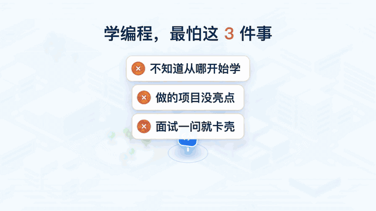
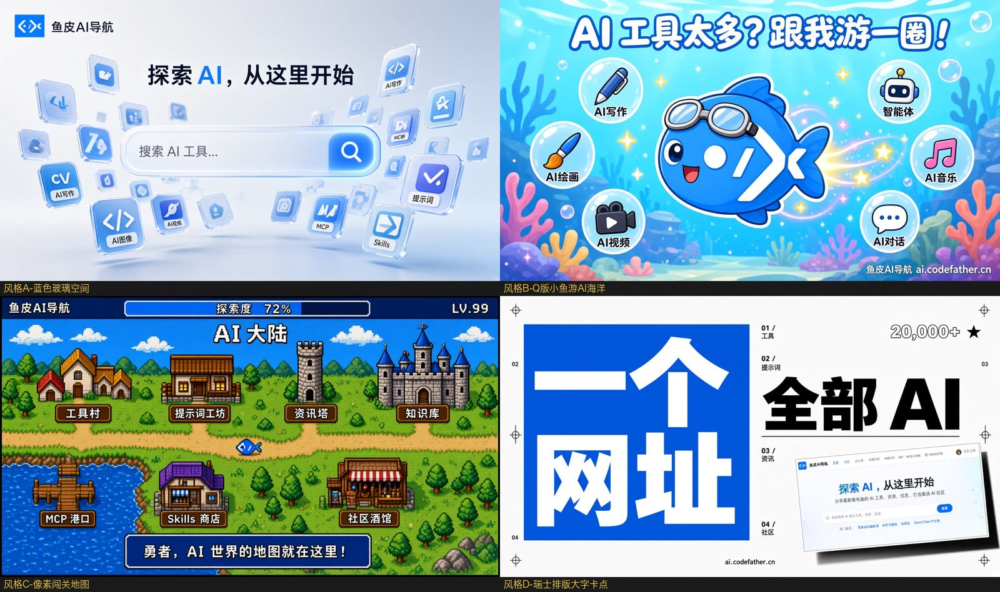
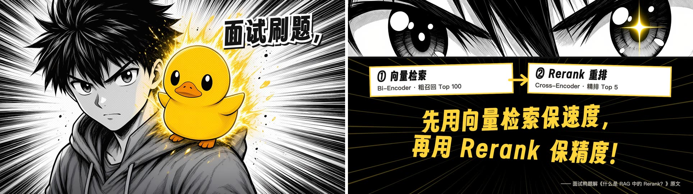
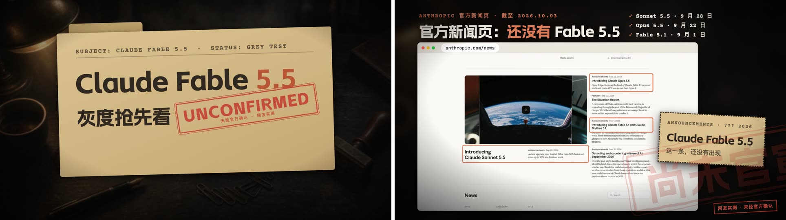
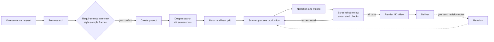

<div align="center">

# Product Promo Video Maker

**Tell the AI in one sentence what you want to promote. It researches, asks questions, takes screenshots, scores music, records narration, edits, and verifies on its own, then hands you a 4K commercial promo video.**

[](LICENSE)




</div>

The animation above shows the opening of five promo videos, one after another. All of them were made with this tool, yet their styles are completely different. A programming-learning community got a light isometric 3D map, an interview practice platform got black-and-white action manga, an AI navigation site got a bright underwater chibi look, an AI model that had not been officially released got a leaked-dossier look, and a beginner programming course became a movie trailer. None of these styles came from a preset template. For each product the AI proposed several directions and drew sample frames, and the product's author picked the final one.

## What this is

Making a decent product promo video usually means working through several stages: writing a script, gathering assets, designing the visuals, cutting to the beat, and mixing narration. Outsourcing one often costs thousands of dollars, and doing it yourself means learning a whole suite of professional software.

This project turns that entire production process into a working specification that an AI can read and follow (`AGENTS.md`), and pairs it with a Remotion video project template and a dozen helper scripts. You can clone the repository locally and open the folder with an AI coding tool such as Cursor, Claude Code, or Codex, or you can install it as a Skill and call it from any project at any time. Either way, all you have to do is describe in one sentence what you want a promo video for. As for what the product's selling points are, what style it should use, and which visuals will move people, the AI researches all of that first and then comes back to you with concrete options.

"Product" here is a broad term: apps, websites, SaaS tools, open-source projects, courses, AI models, communities, and offline events all qualify, as long as they have an interface or a body of work that can be shown.

## Quick start

The production process needs Node.js 18 or newer, Python 3.9 or newer, and ffmpeg. Make sure all three are installed first. The remaining Python dependencies and the browser engine used for screenshots are things the AI will prompt you to install when it runs an environment check before starting.

Then pick one of two ways to use it. If you just want to try it out, or the product you want to promote has no local code, cloning the repository is more direct. If you want to say "make a promo video for this project" at any time inside your own product repository, install it as a Skill.

### Clone the repository and use it directly

Clone the repository locally, then install the Python dependencies and the browser engine used for screenshots.

```bash
git clone https://github.com/liyupi/ai-promo-video-maker.git
cd ai-promo-video-maker
pip install -r template/requirements.txt
playwright install chromium
```

If you are not sure the environment is complete, run the health-check script once. It only checks and never installs anything, and it tells you item by item what is missing and which command will fix it.

```bash
python3 template/scripts/doctor.py
```

Then open this directory with an AI coding tool and you can start. Finished videos are saved under `outputs/<project name>/`.

### Install as a Skill

This repository is itself a standard Agent Skill, so you can install it into Claude Code, Cursor, Codex, and other AI tools with one command using the [skills](https://github.com/vercel-labs/skills) CLI. Adding `-g` installs it to the user directory so every project can use it.

```bash
npx skills add liyupi/ai-promo-video-maker -g
```

After installing, tell the AI "make a promo video for this project" in any project and it will invoke this Skill automatically. This mode is especially well suited to working inside the product's own code repository, because the AI can read the source code, documentation, and README directly and get the most accurate first-hand material. The finished video is saved in the current project's `promo/` directory, and the AI will also remind you to add that directory to `.gitignore` so that several GB of project files do not get committed. To update to the latest version later, run `npx skills update`.

### Configure ElevenLabs (optional)

If you have an [ElevenLabs](https://elevenlabs.io) account, you can copy `.env.example` to the workspace root, rename it to `.env`, and fill in the API key, or you can just set the `ELEVENLABS_API_KEY` environment variable. The AI can then generate narration for the video, compose music and sound effects tailored to the storyboard, and use speech-to-text to check every line of narration for mispronounced words.

You can absolutely make a video without an account. In that case the AI picks music from the free, commercially usable Mixkit library and uses prominent large captions instead of narration.

### Start with one sentence

Whichever way you use it, you start the same way: say one sentence, as if you were handing a task to a colleague. Here are a few common phrasings.

```text
Make a promo video for https://example.com
```

```text
Make a 1-minute intro video for my open-source project, the repository is https://github.com/xxx/yyy
```

```text
Our budgeting app launches next week. Make a vertical promo video I can post on TikTok
```

After you say that, the AI first spends a few minutes learning about your product, then asks you questions over two rounds. The questions cover aspect ratio and duration, target audience, style direction, opening approach, music, and screenshot sources. Each question comes with a recommended option tailored to your product and a reason for it. If you cannot decide, just pick the recommended option, or answer "you decide."

Once you confirm the requirements, the AI does all the remaining work automatically. It only comes back to you in three situations: it needs you to log in to a website so it can take screenshots, it needs you to listen to music and voice samples, or it hits a fact that only you can verify.

### Recommended model

Using **Claude Opus 5.5** or a more advanced model is recommended. A promo video goes through more than a dozen steps, plus repeated rounds of screenshot review and audio verification. The model has to keep the specification's requirements in mind across a very long context while also having a good eye for aesthetics. Weaker models tend to skip the verification steps, or quietly turn every product into the same generic dark tech look.

## The AI shows you sample frames before it starts

Before production begins, the AI proposes 3 to 4 clearly distinct style directions for your product and draws one sample frame for each, so you can see directly "what this style would look like on my product." Below are the 4 sample frames the interview practice platform "Mianshiya" received during the requirements interview. The author ultimately chose the action-manga style in the top-right corner.


The same process applied to an AI navigation site produced completely different candidates. This time the author chose the chibi fish style in the top-right corner, with a mascot designed from the website's logo.



You can pick one, or mix and match, for example "A's color palette with C's characters." The AI writes your choice, along with every other decision, into `requirements.md`, and only starts production once you have confirmed it is correct.

## Finished videos

All five videos below were made with this tool. Each went through several rounds of real revision notes, and those notes were later distilled into rules in the specification.

### Codefather: isometric 3D navigation map

Codefather is a programming-learning community. This video uses code to draw a light isometric 3D city, stringing learning paths, project tutorials, and interview prep into a road leading to a job offer. It opens with three pain points of learning to code; at 4.4 seconds the music drops and the brand appears; then 10 real 4K pages captured after logging in show each section one by one. The music, sound effects, and narration were all generated by ElevenLabs.


### Mianshiya: black-and-white action manga

Mianshiya is a coding-interview practice platform. This video uses a black-and-white manga style, with a single duck-yellow accent color throughout. It opens by firing off the 4 real interview questions with the most views on the site. The music is composed by the AI from the storyboard, with two drops and one breakdown, and the narration explains the answer right during the breakdown. The manga panels are AI-generated and then 4x upscaled so the lines stay crisp in 4K.



### Yupi AI Navigation: bright underwater chibi

Yupi AI Navigation is a site that catalogs AI tools and resources. The star of the video is a little fish based on the website's logo, swimming past browser windows that scroll through real pages from each section of the site. This video went through 5 rounds of revisions, and the rules "let users preview the music first," "screenshots must keep their original aspect ratio," and "verify the pronunciation of the brand name word by word" were all distilled during that process.


### Claude Fable 5.5: leaked-dossier look

This one is an unusual "early look." The AI model version the video covers had not been officially released at the time and was only circulating among users in a limited rollout, so the whole video carries an "unofficially confirmed" label, and every case is traced back to the original post on X with the author and date noted. The video ends with a real screenshot of the official news page to make the point that "the official release has not happened yet."



### Vibe Coding course: movie trailer

This video covers a free beginner course on AI coding. It uses a dark movie-trailer style, opening with the line "you only need to speak plain language" to introduce the course's core idea, then breaking the real application interface into components that "grow" into place one by one on screen.


## Why these videos don't look like templates

Getting an AI to make a video is not hard. The hard part is making one that people want to watch to the end. Most of the effort in this project went into the following things.

**The real product is the star.** Every feature segment needs at least one real interface screenshot or real work sample, with no fewer than 8 across the whole video, plus a fast montage made of 8 or more real work samples. AI-generated images and code-drawn visuals only handle the packaging and transitions. The screenshot script that ships with the project can capture any web page as a 3840x2160 4K image, and when a page needs a login, it opens a browser window and asks you to log in once.

**Pacing has clear standards.** Early videos once drew both "too fast, I can't keep up" and "too slow, it drags" at the same time. So the specification set two floor rules: one ensures captions can be read, such as fast cuts staying on screen for at least 0.65 seconds and URLs for at least 3 seconds; the other ensures the visuals do not drag, such as a pain point or highlight appearing within the first 3 seconds and new information appearing within any 2-second window from that moment on.

**Audio is verified with data.** The AI cannot hear sound, so after narration is generated, every line is transcribed back to text and compared against the script. A single wrong character in a brand name or URL fails the check. After mixing, the whole finished track is transcribed again to confirm no line of narration is buried by the music. Even so, the music and the voice still have to be listened to by you before they are finalized.

**Every step has a gate.** Before rendering, the AI checks for missing files, low-resolution images, and missing glyphs in fonts. After rendering, it checks the finished video's specs, errors in the render log, and overall loudness, then takes screenshots per scene and reviews them one by one against a verification checklist, delivering only when everything passes.

**The rules come from real feedback.** `references/pitfalls.md` collects more than 60 real mistakes that were actually hit, and `references/case-retrospectives.md` records the revision notes each video received and how they were ultimately solved. Before starting the next project, the AI reads through all of this first.

## Workflow

The whole process has 10 stages. Only the requirements confirmation has to be signed off by you; every other stage the AI drives on its own, coming to you only when it needs a login or a listen.



After you receive the video, if anything is unsatisfactory, just tell the AI your notes. It records your exact words in the revision log, works out which steps this change requires redoing, and redoes only the necessary parts. For example, when only swapping the narration voice, it does not re-render the visuals, but replaces the audio track in the finished video directly.

## Project structure

```text
product-promo-video-maker/
├── AGENTS.md        # The AI's working specification, the core of the whole project
├── SKILL.md         # Entry point when installed as a Skill; it just points to AGENTS.md
├── CLAUDE.md        # Makes Claude Code read AGENTS.md too
├── references/      # Detailed methods per stage: requirements interview, style menu, asset sourcing, music and beats, narration, verification checklist, pitfalls, case retrospectives
├── template/        # Every new project is copied from here: Remotion project, web player page, full script set
└── outputs/         # In clone mode, your finished videos go here (never committed to Git)
```

Besides the video file, each finished video's directory also contains `requirements.md` (every decision you signed off and the log of every revision round), `research-notes.md` (the source of every fact and asset), a web player version ready to deploy, and the complete project source code.

## FAQ

**How much does it cost?**
The project itself is completely free. The main cost is the subscription for your AI coding tool. ElevenLabs is optional; narration and sound effects can be generated on the free tier, but content generated on the free tier cannot be used commercially, and composing music from the storyboard requires a paid tier. When you don't use ElevenLabs, the music comes from the free, commercially usable Mixkit library.

**How long does one video take?**
Most of the time goes into the AI's own research, production, and verification. The only parts you take part in are the interview at the beginning and the listen-throughs along the way. The final 4K render generally takes 4 to 18 minutes depending on visual complexity.

**Does it support Windows and Linux?**
The project was mainly polished on macOS, but the scripts themselves do not depend on macOS. On Windows and Linux, fonts automatically fall back to Microsoft YaHei or Noto Sans CJK. If you run into problems, feel free to file an issue.

**Can it make vertical videos?**
Yes. The AI asks about aspect ratio and duration during the requirements interview, and can do landscape, vertical, or both versions.

**How are asset copyrights handled?**
The AI confirms the copyright boundaries with you during the requirements interview and records the source of every asset in `research-notes.md`. One important note: Remotion is free for individuals and companies with 3 or fewer people, while larger teams need to buy a company license. See [Remotion's licensing page](https://www.remotion.dev/license) for details.

**Can I use only part of it to make a video?**
Yes. `template/` is a standalone Remotion project, and the scripts inside it for mixing, beat analysis, 4K screenshots, and finished-video checking can all be used on their own. Each script's usage is documented in the "Script quick reference" section of `AGENTS.md`.

## Contributing

If you made a video you are happy with using this, feel free to share it in an issue. If you hit a new pitfall during production, feel free to add the problem and its solution to `references/pitfalls.md` and open a PR, so the next user's AI can avoid it in advance.

## Credits

This project stands on the shoulders of many excellent tools, including [Remotion](https://www.remotion.dev) for video rendering, [ElevenLabs](https://elevenlabs.io) for AI narration and composition, [Mixkit](https://mixkit.co) for free commercially usable music, [Playwright](https://playwright.dev) for web page screenshots, and [FFmpeg](https://ffmpeg.org) for audio and video processing.

## License

This project is open source under the [MIT](LICENSE) license.
